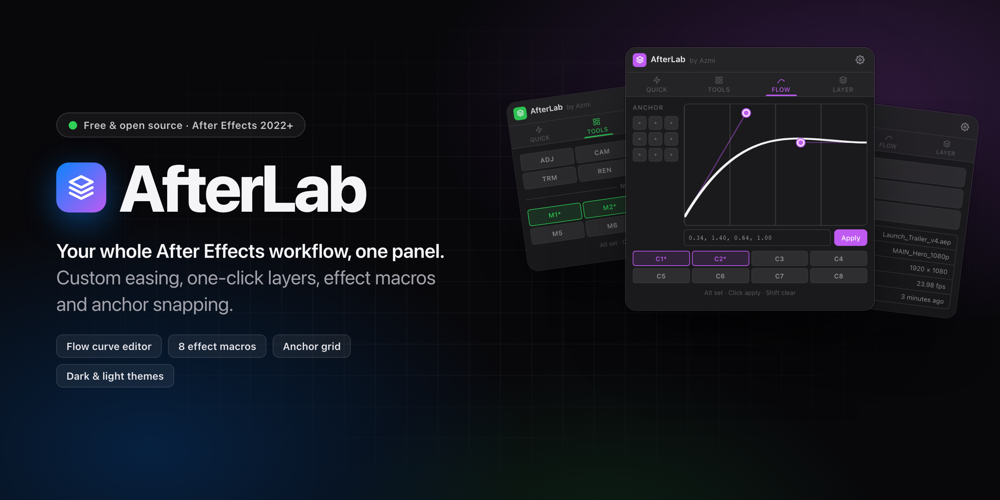
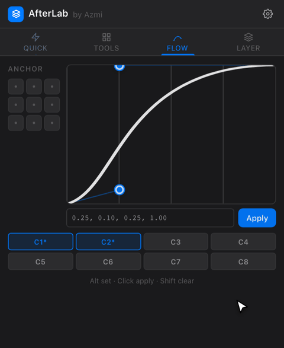
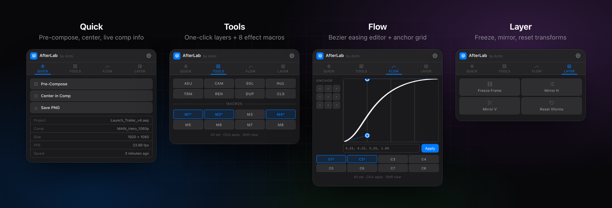
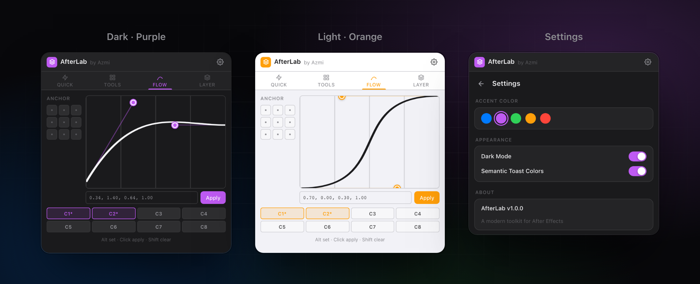

<div align="center">



<br />

# AfterLab

### Your whole After Effects workflow, one panel. Don't pay for shortcuts and macros.

Custom bezier easing, one-click layers, effect macros and anchor snapping, all docked in a single panel.<br />
**Free forever. No account, no license key, no telemetry.**

<br />

[](LICENSE)
[](#-install)
[](#-install)
[](#-contributing)
[](https://github.com/AzmiBousedra/AfterLab/stargazers)

[**Install**](#-install) · [**Features**](#-features) · [**Shortcuts**](#%EF%B8%8F-modifier-cheat-sheet) · [**How it works**](#-how-it-works) · [**Contributing**](#-contributing)

</div>

<br />

## ⚡ See it in action

<div align="center">

<br />
<sub>Drag the handles, <kbd>Alt</kbd>+click a slot to save the curve, hit <b>Apply</b>. Your keyframes are eased.</sub>
</div>

<br />

## 🧪 Why AfterLab?

Most After Effects workflows are a pile of menu dives, half-remembered shortcuts and a few paid scripts. AfterLab puts the things you do every day behind **one click**, in one panel that looks like it belongs in 2026.

|  | |
|---|---|
| 🎯 **Flow curve editor** | Draw a bezier curve, including overshoot, and apply it to any selected keyframes. Save up to 8 curves. |
| 🧬 **Effect macros** | Capture a layer's effect stack (with every value) and paste it onto any layer in one click. |
| ⚓ **Anchor grid** | Snap the anchor point to any of 9 positions without the layer jumping. |
| 🧱 **One-click layers** | Adjustment layer, camera + controller null, solid, null, trim, rename, duplicate. |
| 🎨 **Looks native** | Dark and light themes, 5 accent colours, crisp toasts. Feels like a modern app, not a 2009 ScriptUI dialog. |
| 🔓 **Truly free** | MIT licensed, no license key, no network calls, no telemetry, no build step. About 3,000 lines you can read in an afternoon. |

<br />

## 🧰 Features

<div align="center">

</div>

<br />

<table>
<tr>
<td width="50%" valign="top">

### ⚡ Quick
- **Pre-Compose**: precompose the selected layers, with a name prompt.
- **Center in Comp**: centre every selected layer (keeps Z on 3D layers).
- **Save PNG**: queue the current frame as a PNG in the Render Queue.
- **Live comp info**: project, comp, size, FPS and "saved 3 minutes ago", refreshed every 2 seconds.

</td>
<td width="50%" valign="top">

### 🧱 Tools
| Button | Does |
|---|---|
| `ADJ` | Adjustment layer |
| `CAM` | Camera parented to a 3D controller null |
| `SOL` | Black solid · <kbd>Alt</kbd> opens the native Solid dialog |
| `NUL` | Null · <kbd>Alt</kbd> creates a null **and parents the selection to it** |
| `TRM` | Trim selected layers' out-point to the playhead |
| `REN` | Rename selected layer |
| `DUP` | Duplicate selected layers |
| `CLS` | Close every open comp viewer |

</td>
</tr>
<tr>
<td width="50%" valign="top">

### 〰️ Flow
- **Bezier editor**: drag the two handles; the Y axis stretches automatically for **overshoot and anticipation** curves.
- **Apply**: converts the curve into real After Effects temporal ease (speed + influence) on the selected keyframes, or on every animated transform property of the selected layers.
- **8 curve slots (C1–C8)**: saved to the panel and kept across sessions.
- **Anchor grid**: 9-point anchor snapping that compensates position, scale and rotation so nothing moves on screen.

</td>
<td width="50%" valign="top">

### 🎞️ Layer
- **Freeze Frame**: time-remap hold from the playhead to the end of the work area.
- **Mirror H / Mirror V**: flip the selected layers' scale.
- **Reset Xforms**: centre position, 100% scale, zero rotation, 100% opacity.

### 🧬 Macros (M1–M8)
Capture the selected layer's effects (or just the effects whose properties you've selected) with every parameter value. Apply them to any selection. With nothing selected, AfterLab creates an adjustment layer for you.

</td>
</tr>
</table>

> **Every action is a single undo step.** Press <kbd>Cmd</kbd>/<kbd>Ctrl</kbd>+<kbd>Z</kbd> and it's gone.

<br />

## 🎨 Make it yours

<div align="center">

</div>

Dark or light, five accent colours (blue, purple, green, orange, red), and an optional colour-coded success/error toast. Your choice is remembered.

<br />

## 📦 Install

> **Requirements:** After Effects **2022 (v22) or newer** on macOS or Windows.

**1. Put AfterLab in your CEP extensions folder**

```bash
# macOS
git clone https://github.com/AzmiBousedra/AfterLab.git \
  ~/Library/Application\ Support/Adobe/CEP/extensions/AfterLab
```

```powershell
# Windows (PowerShell)
git clone https://github.com/AzmiBousedra/AfterLab.git "$env:APPDATA\Adobe\CEP\extensions\AfterLab"
```

No git? [Download the ZIP](https://github.com/AzmiBousedra/AfterLab/archive/refs/heads/main.zip), unzip it, and rename the folder to `AfterLab` inside the path above.

**2. Allow unsigned extensions** (one time; AfterLab isn't signed)

```bash
# macOS
defaults write com.adobe.CSXS.11 PlayerDebugMode 1
defaults write com.adobe.CSXS.12 PlayerDebugMode 1
```

```powershell
# Windows
reg add HKCU\Software\Adobe\CSXS.11 /v PlayerDebugMode /t REG_SZ /d 1 /f
reg add HKCU\Software\Adobe\CSXS.12 /v PlayerDebugMode /t REG_SZ /d 1 /f
```

**3. Restart After Effects** and open **Window → Extensions → AfterLab**. Dock it wherever you like.

To update: `git pull` inside the folder, then restart After Effects.

<br />

## ⌨️ Modifier cheat sheet

| Where | Click | <kbd>Alt</kbd> + click | <kbd>Shift</kbd> + click |
|---|---|---|---|
| **Macro slots** `M1–M8` | Apply macro | Capture effects into slot | Clear slot |
| **Curve slots** `C1–C8` | Apply curve to keyframes | Save current curve to slot | Clear slot |
| **`SOL`** | Add black solid | Native Solid Settings dialog | – |
| **`NUL`** | Add null | Null + parent selection | – |

<br />

## 🔬 How it works

AfterLab is a plain [CEP](https://github.com/Adobe-CEP/CEP-Resources) panel: HTML/CSS/JS for the UI and ExtendScript for everything that touches your project. There's no build step, no framework and no dependencies.

```
┌──────────────────────────┐   evalScript("$._AFTERLAB.fn(json)")   ┌──────────────────────────┐
│  Panel  (Chromium/CEF)   │ ─────────────────────────────────────▶ │  host/AfterLabHost.jsx   │
│  index.html · main.js    │ ◀───────────────────────────────────── │  ExtendScript, AE DOM    │
│  styles.css              │        { ok, message, ... } JSON       │  one undo group / action │
└──────────────────────────┘                                        └──────────────────────────┘
```

```
AfterLab/
├── CSXS/manifest.xml       # Extension manifest (host: AEFT 22+, CSXS 11)
├── host/AfterLabHost.jsx   # Every After Effects action lives here
├── lib/CSInterface.js      # Tiny evalScript bridge
├── index.html              # Panel markup
├── main.js                 # UI logic, curve editor, host bridge
└── styles.css              # Themes, accents, components
```

**Flow easing, the short version:** After Effects doesn't take cubic-bezier values; it takes a *speed* and an *influence* per keyframe. AfterLab maps the handle X positions to influence and the handle slopes (Y/X) to a speed multiplier relative to the actual value change between neighbouring keyframes. Vertical handles are clamped to a finite slope, so extreme curves stay stable. The details are in `applyFlowEase()` in [`host/AfterLabHost.jsx`](host/AfterLabHost.jsx).

<br />

## 🤝 Contributing

PRs are very welcome, and adding an action takes about 10 lines:

1. **Host:** add a function to `host/AfterLabHost.jsx` that returns `ok({ message })` or `fail("why")`, wrap edits in `app.beginUndoGroup` / `app.endUndoGroup`, and export it in the `return { ... }` block at the bottom.
2. **UI:** add a button to `index.html`.
3. **Wire it:** `bindAction("btn-id", () => runAction("yourFunction", {}, "Done!"));` in `main.js`.

**Debugging:** with `PlayerDebugMode` on, add a `.debug` file to the extension folder to get Chrome DevTools for the panel (see Adobe's [CEP Resources](https://github.com/Adobe-CEP/CEP-Resources) cookbook). After editing the `.jsx`, close and reopen the panel to reload it.

### Roadmap / good first issues
- [ ] Buttons for actions that already exist in the host: **BG Solid, Vignette, Shape Layer, Gaussian Blur, Camera Lens Blur**
- [ ] Keep effect macros after an After Effects restart (they currently last one session)
- [ ] Ease properties with separated X/Y position from the layer fallback
- [ ] Curve presets library (import/export)
- [ ] Signed ZXP release so step 2 of the install goes away

<br />

## ❓ FAQ

<details>
<summary><b>The panel isn't in Window → Extensions.</b></summary>

Check that the folder sits directly in the `CEP/extensions` path (with `CSXS/manifest.xml` inside it), that you ran the `PlayerDebugMode` command, and that you fully restarted After Effects.
</details>

<details>
<summary><b>The panel says "host is unavailable".</b></summary>

The ExtendScript side failed to load. Close and reopen the panel. If it persists, open an issue with your After Effects version.
</details>

<details>
<summary><b>"Save PNG" didn't write a file.</b></summary>

It adds the frame to the **Render Queue** so you keep full control of the output. Open the Render Queue and click **Render**.
</details>

<details>
<summary><b>Is it really free? What's the catch?</b></summary>

No catch. MIT licensed: use it at work, fork it, ship it in your own toolkit. A ⭐ is appreciated.
</details>

<br />

## 📄 License

[MIT](LICENSE) © Azmi-Salah Bousedra

<div align="center">
<br />
<sub>Built by a motion designer, for motion designers. If AfterLab saved you a click today, <a href="https://github.com/AzmiBousedra/AfterLab">give it a ⭐</a>.</sub>
</div>
